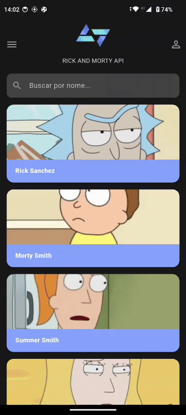
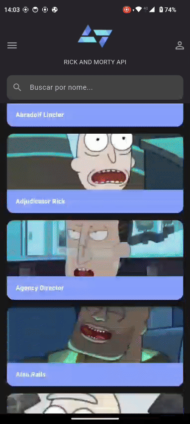
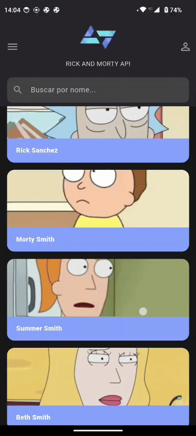
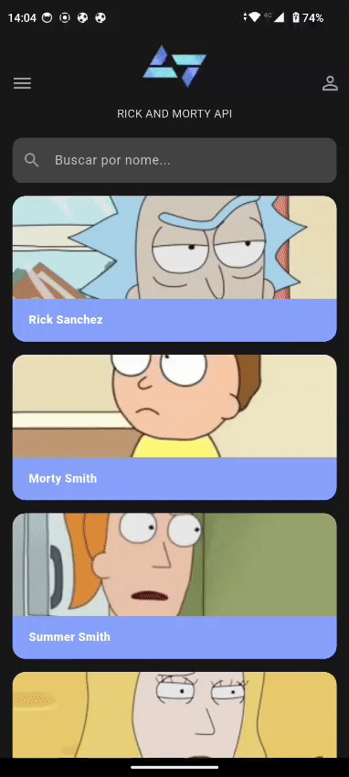

📱 Desafio Flutter - Rick & Morty API

Este projeto é um aplicativo Flutter que consome a The Rick and Morty API para exibir personagens, realizar buscas e mostrar detalhes individuais.
Foi desenvolvido como parte do desafio técnico da Kobe.

## 🎥 Demonstração do App

**Fluxo de Login**

**Listagem de Personagens**

**Tela de Detalhes**

**Busca por Personagem**

**Navegar para tela Sobre**

**Fazer Logout**

------------------------------------------------------------------------------------------------------------------------

✨ Funcionalidades Implementadas
✅ Listagem de personagens com scroll infinito (paginação)

✅ Tela de detalhes completa ao clicar em um personagem

✅ Busca dinâmica por nome de personagem com debounce

✅ Fluxo de autenticação simulada (login/logout)

✅ Persistência do estado de login com shared_preferences

✅ Menu lateral (Drawer) com página "Sobre"

✅ Formatação de datas e tratamento robusto de erros da API

✅ Layout responsivo e fiel ao design proposto

------------------------------------------------------------------------------------------------------------------------

🛠 Arquitetura e Padrões

O projeto segue uma arquitetura limpa, separando responsabilidades para facilitar manutenção, testes e escalabilidade.

Data Layer

Data: Comunicação com a API via Dio (CharacterRepository)

Data/services: Lógica de autenticação simulada (AuthService)

Models: Representação dos dados da API (CharacterModel)

Pages Layer

Camada de UI responsável por renderizar as telas

Gerenciamento de Estado: StatefulWidget com setState e FutureBuilder para chamadas assíncronas iniciais

Widgets Reutilizáveis: MainLayout, CharacterCard, etc.

------------------------------------------------------------------------------------------------------------------------

📦 Dependências Utilizadas

dio - Cliente HTTP robusto

intl - Formatação de datas

shared_preferences - Persistência local

google_fonts - Fonte personalizada (Lato)

------------------------------------------------------------------------------------------------------------------------

🚀 Como Executar o Projeto
Clonar o repositório

git clone https://github.com/AlexJSMartins/kode-start-2025-App-Flutter.git

Entre na pasta do projeto 
cd kode-start-2025-App-Flutter

Instalar dependências
flutter pub get

Rodar o app
flutter run

Credenciais de login simuladas:
Digite o usuario em letra minuscula 

Usuário: kobe 

Senha: 1234

👨 Desenvolvedor

Alex Soares
Site: [www.](https://portfolioalex.com.br/)

https://www.linkedin.com/in/alexjsmartins/
