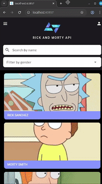
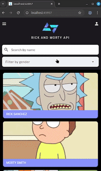
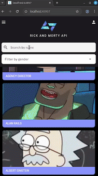
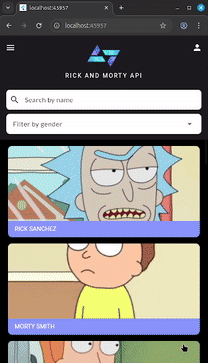

# Rick and Morty Character Explorer

Um aplicativo Flutter moderno e interativo para explorar personagens da série Rick and Morty utilizando a [Rick and Morty API](https://rickandmortyapi.com/).

## Funcionalidades

### Funcionalidades Principais
- **Lista de Personagens**: Visualize todos os personagens em cards
- **Scroll Infinito**: Carregamento contínuo de personagens
- **Detalhes Completos**: Informações detalhadas de cada personagem

### Funcionalidades de Busca e Filtro
- **Busca por Nome**: Encontre personagens por nome completo ou parcial
- **Filtro por Gênero**: Filtre personagens por gênero (Male, Female, Genderless, Unknown)

## 📸 Demonstrações

### Scroll Infinito


### Informações do Personagem


### Busca por Nome


### Filtro por Gênero


## Como Executar

### Pré-requisitos
- Flutter SDK (versão mais recente)
- Dart SDK
- Android Studio ou VS Code
- Dispositivo Android/iOS ou emulador

### Instalação

1. **Clone o repositório:**
```bash
git clone https://github.com/kode-start/projects.git
cd projects/workshop/rick_morty_api
```

2. **Instale as dependências:**
```bash
flutter pub get
```

3. **Execute o aplicativo:**
```bash
flutter run
```

## Arquitetura

### Estrutura do Projeto
```
lib/
├── components/      # Componentes reutilizáveis
├── data/           # Serviços de API e dados
├── models/         # Modelos de dados
├── pages/          # Telas do aplicativo
├── theme/          # Configurações de cores e imagens
└── main.dart       # Ponto de entrada da aplicação
```

### Tecnologias Utilizadas
- **Flutter**: Framework de desenvolvimento
- **HTTP**: Requisições para API

## 🎯 Funcionalidades Detalhadas

### Tela Principal
- Lista todos os personagens em formato de cards
- Implementa scroll infinito 
- Cards exibem nome e imagem do personagem

### Tela de Detalhes
Informações completas do personagem:
- **Básicas**: Nome, imagem, espécie, gênero
- **Status**: Vivo, morto ou desconhecido
- **Localização**: Origem e localização atual
- **Aparições**: Primeira aparição na série

### Sistema de Busca
- **Busca em tempo real** por nome do personagem
- **Filtros avançados** por gênero

## API Utilizada

Este projeto consome a [Rick and Morty API](https://rickandmortyapi.com/), uma API REST pública que fornece:
- Informações de 826+ personagens
- Dados de localização e episódios
- Endpoints organizados e bem documentados


## 👨‍💻 Desenvolvedor

Desenvolvido com ❤️ durante o workshop de Flutter.

---

**Get Schwifty!**